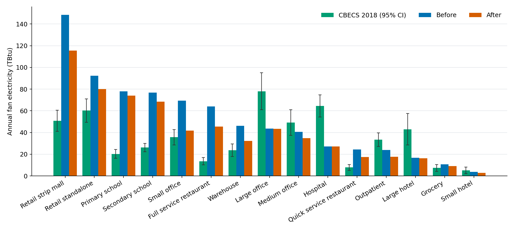

# Issue Report: Supply Fan Motor Efficiency in Older HVAC Systems in ComStock 2025 Release 3

## Summary of Issue
In ComStock 2025 Release 3, small supply fans in buildings with older HVAC systems were modeled with a motor efficiency that is too low. This overestimates fan electricity and cooling energy and underestimates heating energy in these buildings, and overstates the savings of upgrades that replace packaged rooftop units.

## Status
Impacts buildings in ComStock 2025 Release 3 whose HVAC systems follow the DOE Reference Pre-1980 or DOE Reference 1980–2004 templates, primarily those served by packaged single-zone systems. This issue will be fixed in the next ComStock dataset release.

## Details
In ComStock, the efficiency of a building’s HVAC equipment, including its supply fan motors, is based on the energy code in effect when the HVAC system was last replaced (`in.energy_code_followed_during_last_hvac_replacement`). Buildings whose HVAC systems were last replaced based on an energy code before ASHRAE 90.1-2004 use the DOE Reference Pre-1980 or DOE Reference 1980–2004 templates. A software update included in ComStock 2025 Release 3 introduced an error in how fan motor efficiencies are assigned for these two templates.

As a result, supply fans smaller than 1 horsepower in these buildings were modeled with a motor efficiency of 29% instead of the intended 82.5%, so they used almost three times as much electricity as intended to move the same amount of air. Fans of this size are typical of packaged single-zone (PSZ) rooftop units (RTUs) and residential-style split systems. Larger supply fans and pumps on these templates were assigned a slightly lower motor efficiency than intended, which has a much smaller effect. Packaged terminal units (packaged terminal air conditioners \[PTACs\] and packaged terminal heat pumps \[PTHPs\]), fan coils, and other zone equipment are not affected, and neither are buildings whose HVAC systems follow ASHRAE 90.1-2004 or later, or DEER templates, which ComStock uses for all California models.

## Impacts on Energy Results
Because fan motor heat is added to the air the fan delivers, the extra fan electricity also added to cooling loads and offset heating loads. In affected buildings, ComStock 2025 Release 3 therefore overestimates fan electricity and cooling energy and underestimates heating energy. Table 1 summarizes the national impact estimated from internal testing, which compared ComStock simulations with and without the fix.

*Table 1. Estimated change in U.S. commercial building annual energy when the issue is corrected*

| **Fuel and end use**         | **Change when corrected (TBtu)** | **Change when corrected (%)** |
|------------------------------|----------------------------------|-------------------------------|
| Fan electricity              | −139.5                           | −18.2%                        |
| Cooling electricity          | −29.2                            | −3.5%                         |
| Heating electricity          | +7.6                             | +2.5%                         |
| Natural gas heating          | +29.0                            | +2.6%                         |
| Propane and fuel oil heating | +3.3                             | +2.0% to +3.6%                |
| **Total electricity**        | **−161.5**                       | **−4.3%**                     |
| **Total natural gas**        | **+29.0**                        | **+1.3%**                     |
| **Total site energy**        | **−129.2**                       | **−2.0%**                     |

*These estimates come from internal test simulations that use a newer building sample than 2025 Release 3. They show the direction and approximate size of the error in 2025 Release 3, not exact corrections to its values.*

The impact is concentrated in building types where PSZ systems on older HVAC templates are common (Table 2). When corrected, fan electricity in small offices decreases by about 40% and total site energy by about 8%. Warehouses, restaurants, outpatient buildings, small hotels, and strip malls also see fan electricity decrease by more than 20%. Large offices, hospitals, and large hotels, which are mostly served by central variable air volume systems or PTACs, change by less than 3% in fan electricity.

*Table 2. Estimated change in annual energy by building type when the issue is corrected (cooling and heating include all fuels)*

| **Building type**        | **Fan electricity** | **Cooling** | **Heating** | **Total site energy** |
|--------------------------|---------------------|-------------|-------------|-----------------------|
| Small office             | −39.7%              | −11.1%      | +9.8%       | −7.9%                 |
| Warehouse                | −29.9%              | −5.8%       | +1.9%       | −2.3%                 |
| Full service restaurant  | −29.1%              | −8.7%       | +4.7%       | −3.2%                 |
| Quick service restaurant | −28.7%              | −8.8%       | +9.7%       | −3.1%                 |
| Outpatient               | −26.2%              | −4.6%       | +4.2%       | −3.3%                 |
| Small hotel              | −23.5%              | −2.0%       | +5.4%       | −1.7%                 |
| Retail strip mall        | −22.3%              | −5.9%       | +5.7%       | −3.7%                 |
| Grocery                  | −14.9%              | −5.6%       | +1.8%       | −1.1%                 |
| Medium office            | −14.0%              | −2.1%       | +2.1%       | −1.9%                 |
| Retail standalone        | −13.2%              | −3.2%       | +4.1%       | −2.7%                 |
| Secondary school         | −10.8%              | −1.6%       | +1.4%       | −0.9%                 |
| Primary school           | −4.9%               | −0.7%       | +0.8%       | −0.5%                 |
| Large hotel              | −2.8%               | −0.2%       | +0.3%       | −0.1%                 |
| Large office             | −0.5%               | −0.1%       | +0.1%       | −0.1%                 |
| Hospital                 | −0.2%               | 0.0%        | 0.0%        | 0.0%                  |

*Source: internal test simulations, as in Table 1.*

This issue is a major contributor to ComStock fan electricity being higher than estimates from the 2018 Commercial Buildings Energy Consumption Survey (CBECS). In internal testing, national fan electricity was about 48% above the CBECS estimate with the issue and about 21% above it after the fix (Figure 1). Note that the fan energy presented in CBECS is a disaggregated estimate rather than directly measured data.

{:refdef: style="text-align: center;"}

{:refdef}

{:refdef: style="text-align: center;"}
*Figure 1. Annual fan electricity by building type from internal testing: CBECS 2018 with its 95% confidence interval, ComStock with the issue (Before), and ComStock with the fix (After)*
{:refdef}

## Affected Files and Upgrade Results
All ComStock 2025 Release 3 data products that report energy for affected buildings carry this issue, including the metadata and annual results files and the timeseries files on the Open Energy Data Initiative (OEDI) data lake, and the Data Viewer. The most affected fields are:
- Fan electricity (fields beginning with `out.electricity.fans`)
- Cooling and heating energy for all fuels
- Electricity, natural gas, and site energy totals and energy use intensities (EUIs), along with the utility bills and emissions calculated from them

The issue has a larger effect on the files for upgrade measures that replace packaged RTUs or their supply fans, such as the heat pump RTU, advanced RTU, advanced RTU controls, and ground source heat pump upgrades, and the packages that include them (complete list shown in Table 3). These upgrades assign their own efficiency to the new fans, so their upgrade results are less affected, but the baseline they are compared against uses too much fan energy. As a result, fan energy savings and total energy savings for these upgrades in 2025 Release 3 are likely overstated, in some cases substantially. In internal testing, correcting the issue lowered baseline fan electricity by about 25% in the buildings where the heat pump RTU upgrades apply. The DOAS with mini-split heat pump upgrade keeps the building’s existing supply fan, so its upgrade results carry the same issue as the baseline.

*Table 3. Most-affected 2025 ComStock Release 3 upgrades*

| **Measure ID** | **Upgrade name**                                                                    |
|----------------|-------------------------------------------------------------------------------------|
| hvac_0001      | HP Boiler, Electric Backup                                                          |
| hvac_0002      | HP Boiler, Gas Backup                                                               |
| hvac_0003      | DOAS HP Minisplits                                                                  |
| hvac_0004      | Variable Speed HP RTU, Original Heating Fuel Backup                                 |
| hvac_0005      | Variable Speed HP RTU, Electric Backup                                              |
| hvac_0006      | VRF with DOAS                                                                       |
| hvac_0010      | VRF with 25pct Upsizing Allowance                                                   |
| hvac_0011      | Standard Performance HP RTU, Electric Backup + New Windows                          |
| hvac_0012      | Unoccupied AHU Control                                                              |
| hvac_0013      | Variable Speed HP RTU, Electric Backup, Energy Recovery                             |
| hvac_0014      | Advanced RTU Controls                                                               |
| hvac_0015      | Hydronic Water-to-Water Geothermal Heat Pump                                        |
| hvac_0016      | Packaged Water-to-Air Geothermal Heat Pump                                          |
| hvac_0017      | Console Water-to-Air Geothermal Heat Pump                                           |
| hvac_0018      | Standard Performance HP RTU, Electric Backup                                        |
| hvac_0019      | Standard Performance HP RTU, Electric Backup + Roof Insulation                      |
| hvac_0020      | Standard Performance HP RTU, Electric Backup, 32F Lockout                           |
| hvac_0021      | Commercial HVAC Challenge HP RTU, Electric Backup, -10F Lockout                     |
| hvac_0023      | Standard Performance HP RTU, Electric Backup, 2F Unoccupied Htg Thermostat Setback  |
| hvac_0025      | Standard Performance HP RTU using Lab Data, Electric Backup                         |
| hvac_0028      | Advanced RTU                                                                        |
| pkg_0002       | Package 2, LED Lighting + Variable Speed HP RTU or HP Boilers                       |
| pkg_0003       | Package 3, Package 1 + Package 2                                                    |
| pkg_0004       | Package 4, Package 2 with Standard Performance HP RTU                               |
| pkg_0005       | Package 5, Variable Speed HP RTU or HP Boilers + Economizer + DCV + Energy Recovery |
| pkg_0006       | Package 6, Hydronic GHP or Packaged GHP or Console GHP                              |
| pkg_0010       | Package 10, Package 1 + Package 6                                                   |
| pkg_0011       | Package 11, Package 10 + LED Lighting                                               |

## Recommendations
This issue will be fixed in the next ComStock dataset release (expected December 2026), and we recommend using the latest ComStock dataset release once it is available. Updating is most important for analyses focused on fan, cooling, or heating energy; on building types with many PSZ systems, such as small offices, restaurants, retail, warehouses, and outpatient buildings; or on savings from upgrades that replace packaged RTUs. National total energy results are less affected, with total site energy changing by about 2%.

Users who need to work with ComStock 2025 Release 3 in the meantime can identify affected buildings with `in.energy_code_followed_during_last_hvac_replacement` (“DOE Ref Pre-1980” or “DOE Ref 1980-2004”) together with `in.hvac_system_type`, and should treat fan electricity and packaged RTU upgrade savings for the measures listed above for these buildings as likely overestimates.
