# ComStock Building Counts

## Background
For commercial buildings, the primary way to analyze and discuss energy consumption data is to use energy per floor area metrics, such as energy use intensity (EUI).[^1] This is driven by the fact that commercial buildings vary widely in size,[^2] and the fact that many of the major thermal loads and end uses tend to vary proportionally to floor area. For these reasons, the focus of ComStock is on matching floor area totals and the associated energy consumption within a given geography.

As described in the reference documentation, ComStock results come from the joining of information from a building inventory with modeled simulation results. While ComStock is much more granular and robust than many other sources available on a national scale, the building inventory has known gaps, imperfect building type classification, and other unknown imperfections. The first step after simulation is to assign three ComStock models to each of the real buildings in the building inventory. Three models are used to avoid conveying the impression that any one model perfectly matches a specific real building. The weights for each model are scaled such that the weighted total floor area matches the area of the buildings in the building inventory.

To handle the issues in the building inventory, another step is performed. Using the Commercial Building Energy Consumption Survey (CBECS) from the U.S. Energy Information Administration (EIA), national multipliers are calculated to scale the weighted square footage of each building type from the amount shown in the building inventory to the CBECS national totals. Sometimes, these multipliers are greater than one, and others are less than one. Multipliers less than one likely result from building types being systematically misclassified in the building inventory.

The practical implication of this approach is that building counts are not a primary focus of ComStock. Each step in the weighting process is designed to match floor area, not the number of buildings. Assigning three models to each real building, scaling their weights to match each building’s floor area, and applying CBECS multipliers by building type all calibrate the weighted square footage. None of these steps constrain how many buildings the results represent. As a result, any building count derived from ComStock is a by-product of the floor area calibration. It also inherits the gaps and classification errors in the building inventory. Counts can still be estimated from ComStock results, but they should be treated as more uncertain than the floor area and energy consumption totals that the methodology is built to match. Whether the accuracy of ComStock’s estimates is suitable for a use case is a judgment call that users must make themselves.

## Building Count Estimates
Although providing building count estimates is not the primary focus of ComStock, ComStock results can be used for this purpose. The following sections describe our recommended methodology as well as our assessment of the results.

### Recommended Methodology
The recommended methodology is to sum the “weight” column (often referred to as “ComStock weight”) in the published metadata and annual results tables on the Open Energy Data Initiative (OEDI) data lake.

### Accuracy of Building Count Estimates
Providing building count estimates is not the primary focus of ComStock. Whenever possible, results should be presented as totals or normalized to floor area. When this is not possible, a reasonable statement is that the ComStock team believes the “true building count” lies somewhere between 50% and 200% of the ComStock estimates calculated by summing the weights on a national basis for most building types. In addition, building count estimates depend on how a “building” is defined; even a highly accurate estimate may differ from another source if the sources use different accounting scopes or counting conventions. For example, one source might count an entire strip mall as a single building, while another counts each unit within it separately. Whether the accuracy of ComStock’s estimates are suitable for a use case is a judgment call that users must make themselves.

Narrowing down to specific building types, geographies, or other filters increases the uncertainty in the estimates used for comparison and the ComStock estimates. Users who have more localized data are encouraged to perform their own comparisons where possible, taking careful consideration of building type classification and its possible impact on the results.

## Comparing the Estimates
First, it is important to understand the building count estimates being compared.

### CBECS
CBECS is a survey-estimated dataset produced by the EIA. Along with the estimated building counts, CBECS also includes relative standard error (RSE). Using a formula provided by EIA, Table 1 below showing 95% confidence intervals was calculated. Even at the national scale, the confidence intervals for the survey data can be wide, and when broken down by census division, much wider still (several combinations exceeding +/-150%).

{:refdef: style="text-align: center;"}
*Table 1. CBECS Building Count 95% Confidence Interval*
{:refdef}

{:refdef: style="text-align: center;"}
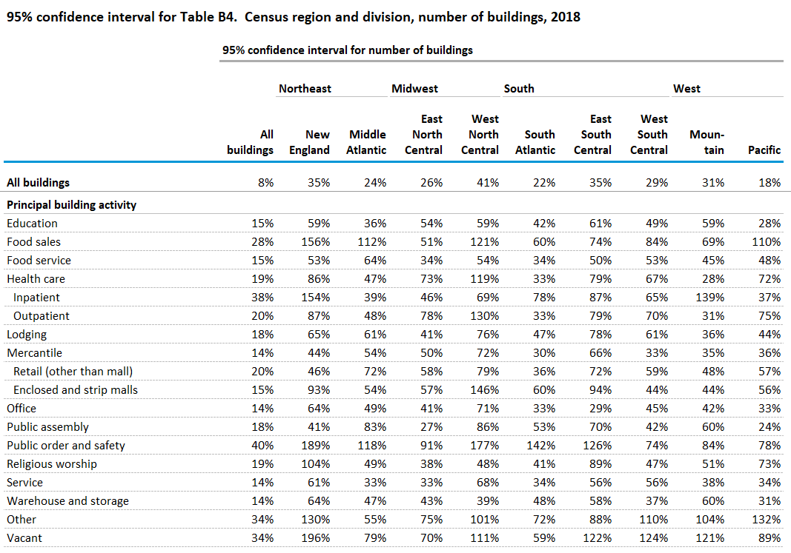
{:refdef}

Additionally, CBECS only provides direct estimates of building count using the less granular building types. In some cases, ComStock only models a subset of the buildings in each type. Therefore, it is expected that the ComStock counts would be lower than the CBECS counts. Figure 1 below shows that for Office, Education, Lodging, Food Service, and Food Sales building types. ComStock deliberately models most but not all of the floor area based on our assessment of the appropriateness of our building types to represent portions of the commercial building stock. Please see our explanation titled [Building Types Not Included in ComStock]({{  site.baseurl  }}) for more details.

Lastly, the CBECS building counts in the plots by building type and census division below come from Table B4 of the [CBECS 2018 published data tables](https://www.eia.gov/consumption/commercial/data/2018/#b3-b5). EIA withholds estimates in these tables where the RSE is greater than 50% or the reporting sample had fewer than 20 buildings. As a result, some CBECS columns are missing for this reason. In contrast, the CBECS counts in the plots by census division and building size bin are calculated by summing the weights in the CBECS microdata. These plots therefore include CBECS values for more combinations of building type and census division, although those values can have large relative errors.

{:refdef: style="text-align: center;"}
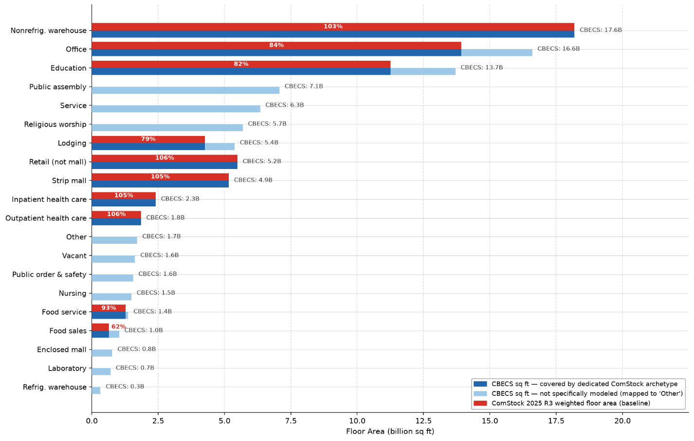
{:refdef}

{:refdef: style="text-align: center;"}
*Figure 1. CBECS 2018 vs. ComStock Floor area by CBECS Principal Building Activity (PBA).*
{:refdef}

### ComStock Building Inventory
As described in more detail in Section 3.1.1 of the [ComStock Reference Documentation: 2025 Release 3]({{  site.baseurl  }}/assets/files/comstock_reference_documentation_2025_3.pdf), the Building Inventory combines a variety of data sources, including CoStar, HIFLD (Department of Homeland Security [DHS] critical infrastructure), and Microsoft Building Footprints. The Building Inventory is known to have less robust coverage in areas with weaker real-estate markets. For hospitals, floor area is estimated based on bed count. For schools, the floor area is estimated based on student enrollment.

### Comparison – All Building Types
Figure 2 shows a comparison of national counts for all building types across all three data sources: ComStock weights, ComStock building inventory, and CBECS. Overall, the three data sources show a mixed pattern of alignment.

Because each building type has its own nuances, it is discussed in its own dedicated section. Each section includes figures broken down by census division, as well as by census division and building size bin (floor area) for that building type. ComStock building types do not map one-to-one to CBECS principle building activities (PBAs). Table 1 of the [ComStock Reference Documentation: 2025 Release 3]({{  site.baseurl  }}/assets/files/comstock_reference_documentation_2025_3.pdf) provides a mapping between ComStock building types and CBECS PBAs. In the figures by census division, ComStock and Building Inventory counts are aggregated to CBECS PBAs using this mapping, and the CBECS values are the published building counts for each entire PBA. They are not limited to the subset of each PBA that overlaps with ComStock building types, so they include subcategories that ComStock does not model, such as nursing homes and dormitories in the Lodging PBA.

{:refdef: style="text-align: center;"}
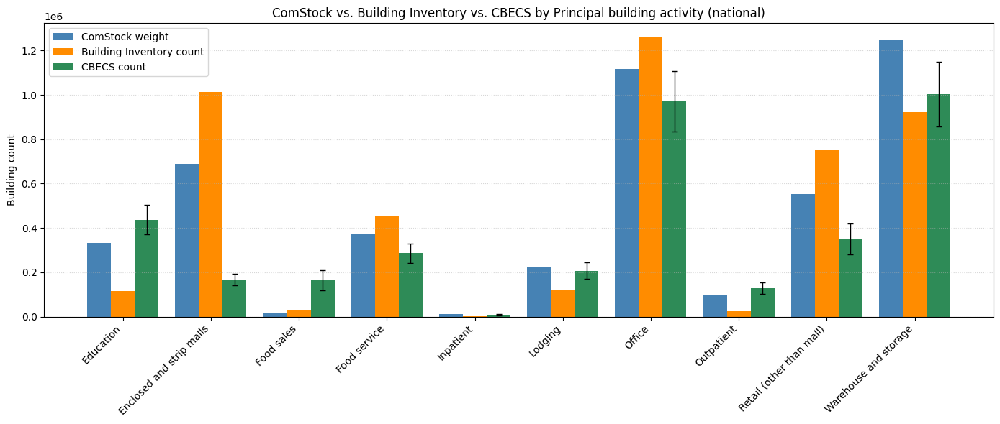
{:refdef}

{:refdef: style="text-align: center;"}
*Figure 2. National building count comparison by CBECS PBA*
{:refdef}

### Comparison – Education
ComStock Primary and Secondary Schools map to the Education CBECS PBA.

As shown in Figure 3, CBECS estimates are much higher than the Building Inventory for education buildings. At least some difference is expected, as CBECS includes college/university and preschool/daycare, while the Building Inventory and ComStock only include primary and secondary schools. In CBECS, these additional building types represent 20% of the floor area of this building type. Additionally, for Education buildings, the floor area in the Building Inventory is inferred from student enrollment numbers, not reported.

Another possible reason for the difference is that the Building Inventory assumes each school is a single building, while CBECS counts each building within a school separately. Seventy percent of the CBECS entries modeled in ComStock are part of a multi-building complex, with the average between 2 and 4 buildings in the complex. This would especially help explain the much higher number for CBECS in the Pacific division, which makes sense, because many schools in California have multiple buildings separated by open-air breezeways instead of one large building with internal hallways.

In 6 of 8 reported census divisions, the ComStock estimate falls inside the CBECS 95% CI.

Figure 4 and Figure 5 compare school building counts across three data sources by census division and floor-area size bin, for the Primary school and Secondary school building types, respectively. For both types, CBECS leads the under-12k sqft bin in several divisions (notably a large Pacific spike for Primary School), while ComStock leads the 52k–150k bin across most divisions. In the 12k–52k bin, ComStock is generally the highest source for Secondary school, whereas the sources are more mixed for Primary school. The Building Inventory is consistently the lowest source across both types.

{:refdef: style="text-align: center;"}
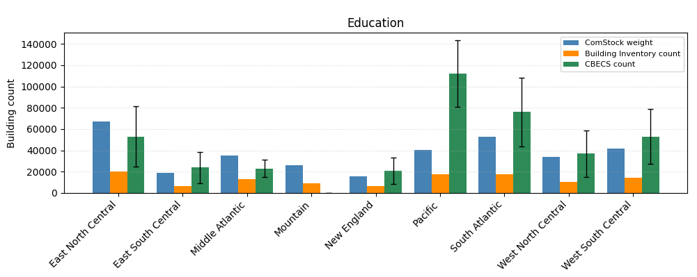
{:refdef}

{:refdef: style="text-align: center;"}
*Figure 3. Education building count comparison by census division*
{:refdef}

{:refdef: style="text-align: center;"}
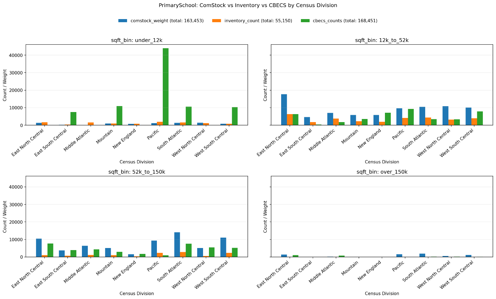
{:refdef}

{:refdef: style="text-align: center;"}
*Figure 4. Primary school building count comparison by census division and building size bin*
{:refdef}

{:refdef: style="text-align: center;"}
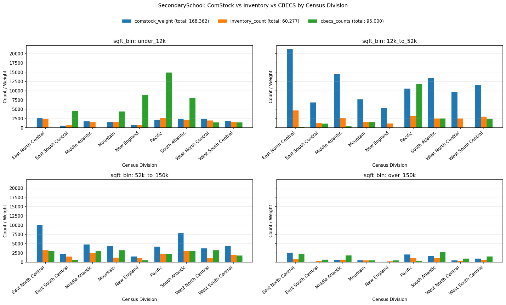
{:refdef}

{:refdef: style="text-align: center;"}
*Figure 5. Secondary school building count comparison by census division and building size bin*
{:refdef}

### Comparison – Enclosed and Strip Malls
ComStock Strip malls map to the Enclosed and Strip Malls CBECS PBA.

As shown in Figure 6, the Building Inventory is several times higher than CBECS for enclosed and strip malls. This potentially indicates a difference in building type classification between the two datasets.

Figure 7 compares Retail Strip mall building counts across three data sources by census division and floor-area size bin. Almost all buildings fall in the under-12k sqft bin, where the Building Inventory substantially exceeds both ComStock and CBECS across nearly all divisions, and CBECS runs notably low.

{:refdef: style="text-align: center;"}
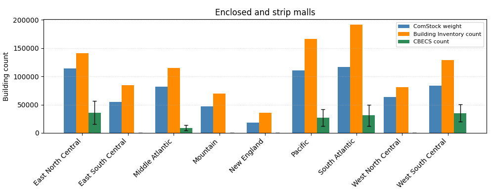
{:refdef}

{:refdef: style="text-align: center;"}
*Figure 6. Enclosed and Strip Mall building count comparison by census division*
{:refdef}

{:refdef: style="text-align: center;"}
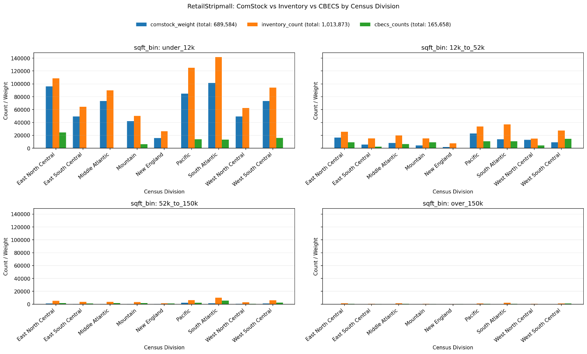
{:refdef}

{:refdef: style="text-align: center;"}
*Figure 7. Strip mall building count comparison by census division and building size bin*
{:refdef}

### Comparison – Food Sales
ComStock Grocery buildings map to the Food Sales CBECS PBA.

As shown in Figure 8, CBECS only provides a count estimate for one census division, and the CBECS estimate is much higher than the Building Inventory. This is expected, as the Building Inventory and ComStock only include grocery stores, while CBECS includes the more numerous convenience stores, corner stores, and liquor stores. While these stores make up only around one third of the floor area of the category, they make up a large portion of the count. Therefore, the large gap is expected and reflects a difference in accounting scope rather than an obvious issue with the estimates.

The ComStock estimate aligns more closely with the Building Inventory for all census divisions.

Figure 9 compares Grocery building counts across three data sources by census division and floor-area size bin. These charts show CBECS counts from the CBECS microdata, which show results for more census divisions than the published data tables used in the census division plots, albeit with larger relative errors. In the under-12k sqft bin, CBECS is generally the highest source while ComStock and the Building Inventory run lower. For the 12k–52k and 52k–150k bins, the Building Inventory tends to dominate, with ComStock notably lower relative to both other sources across most divisions.

{:refdef: style="text-align: center;"}
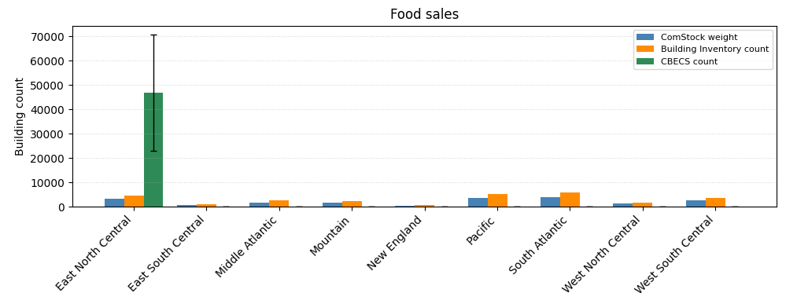
{:refdef}

{:refdef: style="text-align: center;"}
*Figure 8. Food sales building count comparison by census division*
{:refdef}

{:refdef: style="text-align: center;"}
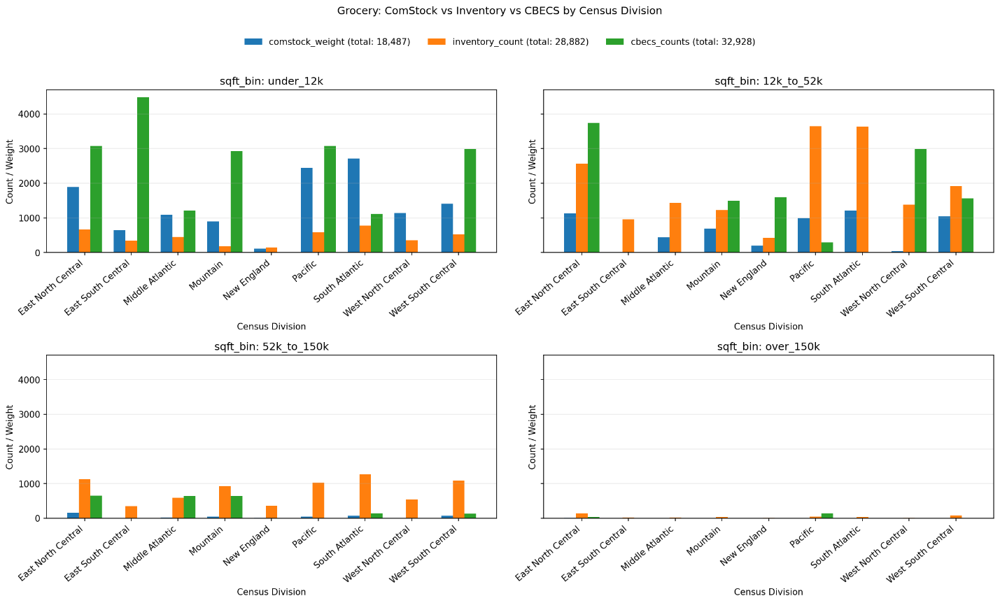
{:refdef}

{:refdef: style="text-align: center;"}
*Figure 9. Grocery building count comparison by census division and building size bin*
{:refdef}

### Comparison – Food Service
ComStock Full- and Quick-services restaurants map to the Food Service CBECS PBA.

Figure 10 shows that the Building Inventory is somewhat higher than CBECS for food service buildings. We do not have a hypothesis to explain the difference.

In 3 of 4 reported divisions, the ComStock estimate falls inside the CBECS 95% CI.

Figure 11 and Figure 12 compare building counts across three data sources by census division and floor-area size bin for Full-service restaurants and Quick-service restaurants, respectively. Almost all buildings fall in the under-12k sqft bin, where Building Inventory generally exceeds both ComStock and CBECS across most divisions. The larger size bins are effectively empty, reflecting the small floor area typical of these building types.

{:refdef: style="text-align: center;"}
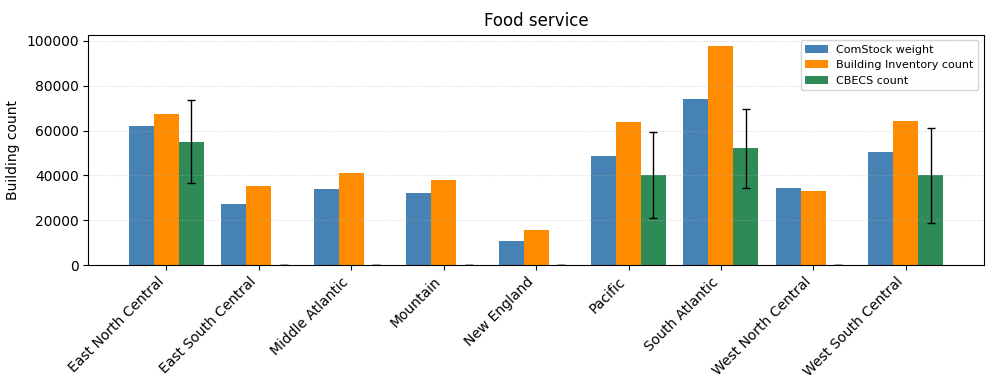
{:refdef}

{:refdef: style="text-align: center;"}
*Figure 10. Food service building count comparison by census division*
{:refdef}

{:refdef: style="text-align: center;"}
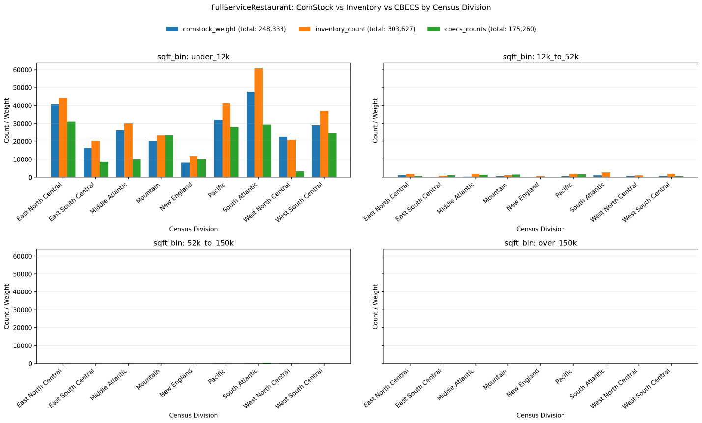
{:refdef}

{:refdef: style="text-align: center;"}
*Figure 11. Full-service restaurant building count comparison by census division and building size bin*
{:refdef}

{:refdef: style="text-align: center;"}
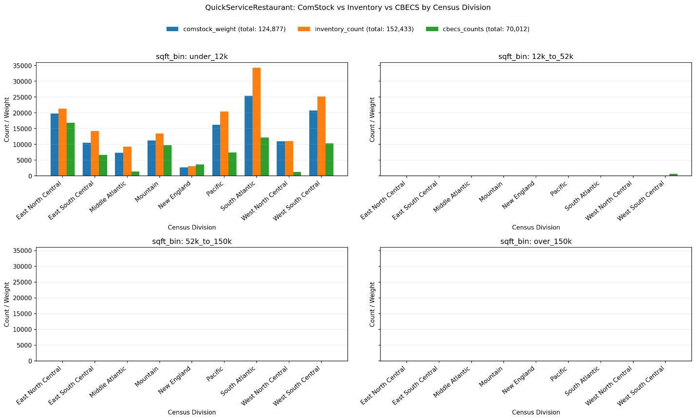
{:refdef}

{:refdef: style="text-align: center;"}
*Figure 12. Quick-service restaurant building count comparison by census division and building size bin*
{:refdef}

### Comparison – Inpatient
ComStock Hospitals map to the Inpatient CBECS PBA.

As shown in Figure 13, the Building Inventory is generally much lower than CBECS, and the CBECS 95% CIs are wide. In the Building Inventory, the building count is taken from the HIFLD data, but the floor area is estimated based on the number of beds. CBECS reports multiple buildings in a hospital as multiple buildings, while the Building Inventory reports them as one single, large building. For low-frequency, high-area building types like Hospitals, ComStock’s focus on floor area could skew the accuracy of the building count substantially.

Figure 14 compares Hospital building counts across three data sources by census division and floor-area size bin. The smaller size bins are sparse, with CBECS showing scattered mid-size counts, supporting the assertion that CBECS counts smaller medical facilities individually as “Hospital.” Most buildings fall in the over-150k sqft bin, where ComStock substantially exceeds both the Building Inventory and CBECS across nearly all divisions.

{:refdef: style="text-align: center;"}
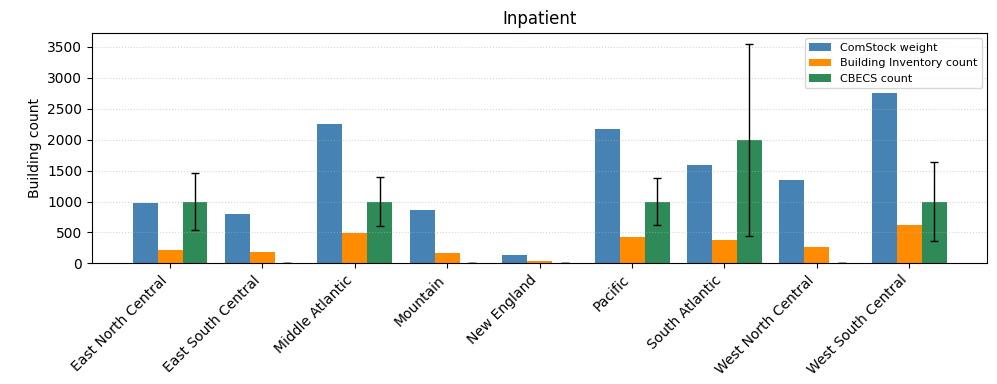
{:refdef}

{:refdef: style="text-align: center;"}
*Figure 13. Inpatient building count comparison by census division*
{:refdef}

{:refdef: style="text-align: center;"}
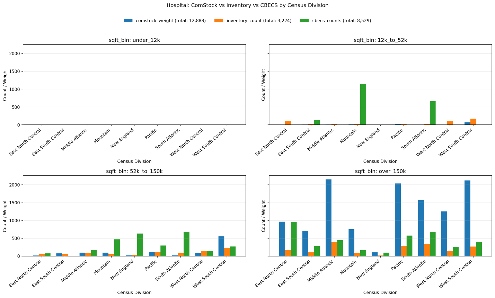
{:refdef}

{:refdef: style="text-align: center;"}
*Figure 14. Hospital building count comparison by census division and building size bin*
{:refdef}

### Comparison – Lodging
ComStock Small and Large hotels map to the Lodging CBECS PBA.

For lodging, CBECS includes nursing homes and dormitories, which make up about 20% of the floor area of this type in CBECS. The Building Inventory and ComStock do not include these types and instead focus on small and large hotels, so they are expected to be lower than CBECS in Figure 15, which shows the published CBECS counts for the entire Lodging PBA.

In 5 of 8 reported divisions, the ComStock estimate falls inside the CBECS 95% CI.

Figure 16 compares Small hotel building counts across three data sources by census division and floor-area size bin. ComStock is generally the highest source in the under-12k sqft bin across most divisions, while the three sources track more closely in the 12k–52k bin. The larger size bins are nearly empty, reflecting the small floor area typical of this building type.

Figure 17 compares Large hotel building counts across three data sources by census division and floor-area size bin. ComStock notably exceeds both the Building Inventory and CBECS in the 12k–52k sqft bin across nearly all divisions and also runs high in the under-12k bin in several divisions. The three sources track more closely in the larger size bins.

{:refdef: style="text-align: center;"}
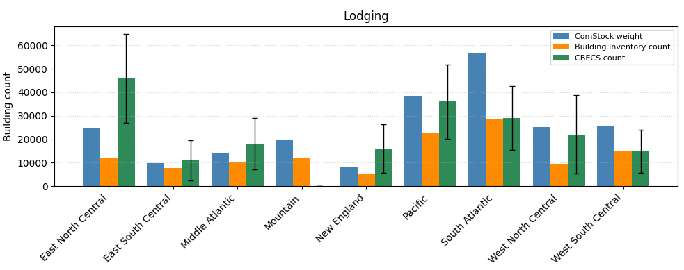
{:refdef}

{:refdef: style="text-align: center;"}
*Figure 15. Lodging building count comparison by census division*
{:refdef}

{:refdef: style="text-align: center;"}
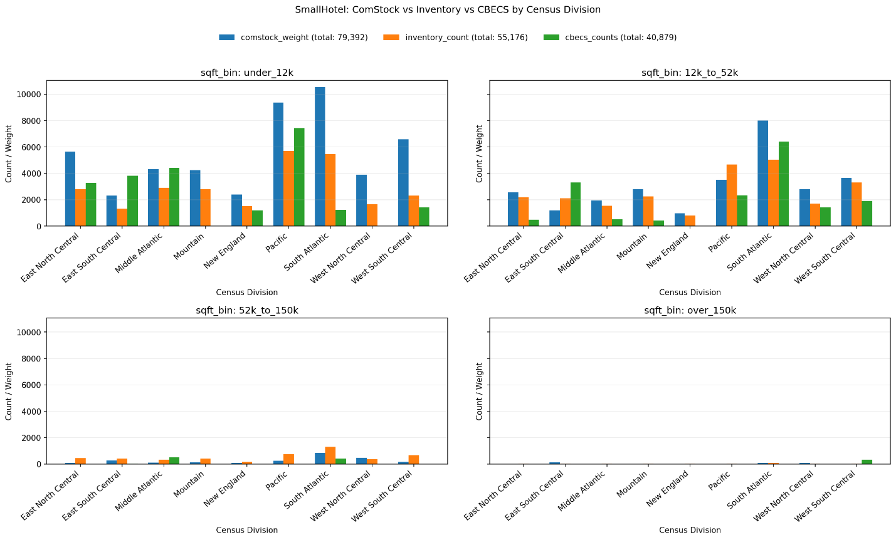
{:refdef}

{:refdef: style="text-align: center;"}
*Figure 16. Small hotel building count comparison by census division and building size bin*
{:refdef}

{:refdef: style="text-align: center;"}
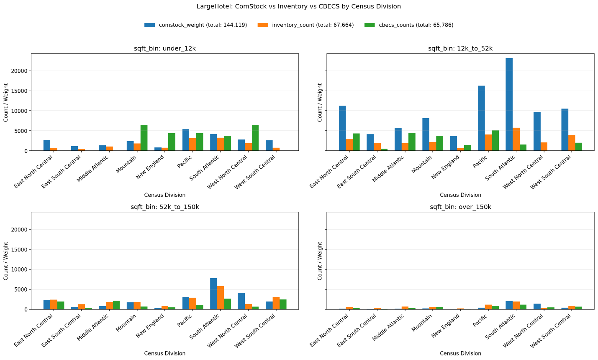
{:refdef}

{:refdef: style="text-align: center;"}
*Figure 17. Large hotel building count comparison by census division and building size bin*
{:refdef}

### Comparison – Office
ComStock Small, Medium and Large offices map to the Office CBECS PBA.

For offices, CBECS includes mixed-use office, which make up about 15% of the floor area of this type in CBECS. The Building Inventory and ComStock do not include these types, so they are expected to be lower than CBECS. This does not generally appear to be happening. Because the office building type is assigned to many CoStar property types, one of the differences could be building type classification in the Building Inventory.

In 6 of 8 reported divisions, the ComStock estimate falls inside the CBECS 95% CI. However, the CBECS number is expected to include additional buildings.

Figure 19, Figure 20, and Figure 21 compares office building counts across three data sources by census division and floor-area size bin, spanning the Small office, Medium office, and Large office building types, respectively. The CBECS counts in these figures are divided into Small, Medium, and Large office using CBECS’s own size definitions, which differ from the definitions ComStock uses to assign its office building types. As a result, each figure compares counts that were grouped using different size definitions, and differences between ComStock and CBECS within a single office type should be interpreted with caution. Comparing total office counts across all three types, as in the census division comparison for all offices, avoids this issue.

For Small office, nearly all buildings fall in the under-12k sqft bin, where ComStock and the Building Inventory track closely and CBECS runs somewhat lower; the remaining bins are effectively empty. For Medium office, ComStock is generally the highest source in the under-12k bin, but the Building Inventory dominates the 12k–52k and 52k–150k bins with ComStock well below both other sources. For Large office, ComStock exceeds the others in the 12k–52k bin, while the Building Inventory and CBECS substantially exceed ComStock in the over-150k bin across most divisions. Taken together, ComStock tends to skew each office type toward smaller footprints relative to the Building Inventory and CBECS. The difference relative to CBECS may partly reflect these different size definitions rather than a real difference in the building stock.

{:refdef: style="text-align: center;"}
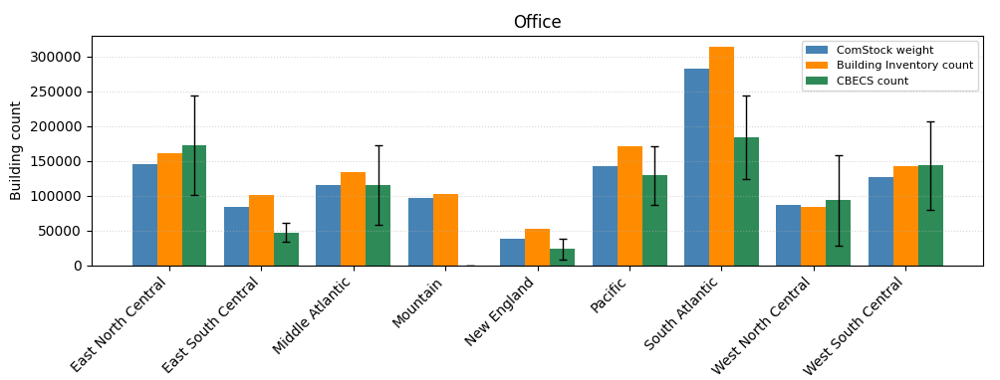
{:refdef}

{:refdef: style="text-align: center;"}
*Figure 18. Office building count comparison by census division*
{:refdef}

{:refdef: style="text-align: center;"}
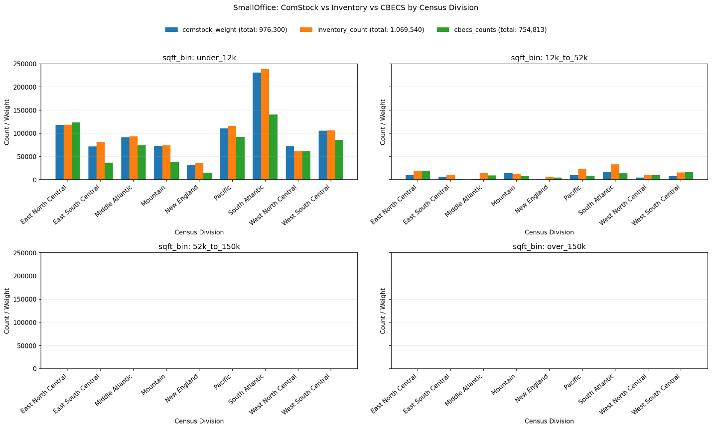
{:refdef}

{:refdef: style="text-align: center;"}
*Figure 19. Small office building count comparison by census division and building size bin*
{:refdef}

{:refdef: style="text-align: center;"}
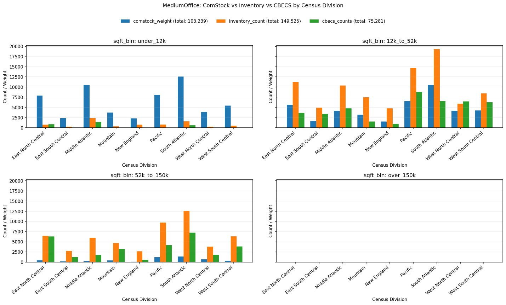
{:refdef}

{:refdef: style="text-align: center;"}
*Figure 20. Medium office building count comparison by census division and building size bin*
{:refdef}

{:refdef: style="text-align: center;"}
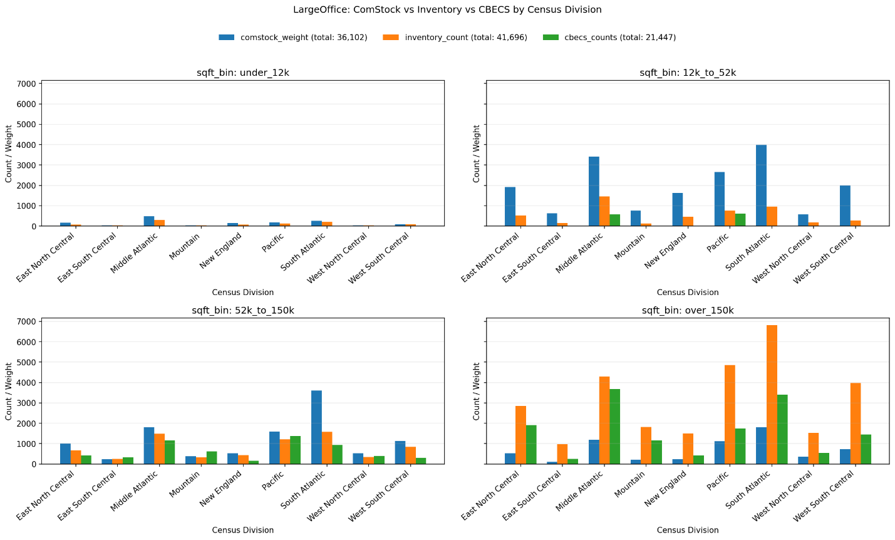
{:refdef}

{:refdef: style="text-align: center;"}
*Figure 21. Large office building count comparison by census division and building size bin*
{:refdef}

### Comparison – Outpatient
ComStock Outpatient buildings map to the Outpatient CBECS PBA.

As shown in Figure 22, the Building Inventory estimates a much lower count of outpatient buildings than CBECS. This could be because CBECS includes outpatient buildings owned or associated with hospitals, while the Building Inventory misses these and classifies them as Inpatient/Hospital.

In 4 of 4 reported divisions, the ComStock estimate falls inside the CBECS 95% CI, although the CBECS 95% CIs are notably large for this building type.

Figure 23 compares Outpatient building counts across three data sources by census division and floor-area size bin. Most buildings fall in the under-12k sqft bin, where CBECS is generally the highest source and the Building Inventory the lowest. ComStock exceeds the Building Inventory across most bins and divisions, though it trails CBECS in the smallest bin, and Building Inventory appears to undercount this building type overall.

{:refdef: style="text-align: center;"}
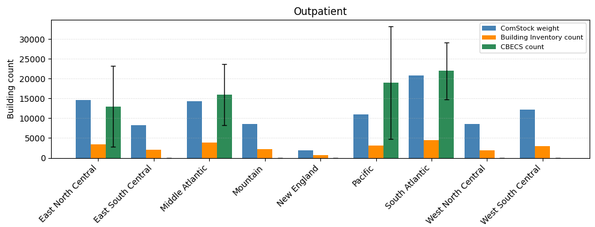
{:refdef}

{:refdef: style="text-align: center;"}
*Figure 22. Outpatient building count comparison by census division*
{:refdef}

{:refdef: style="text-align: center;"}
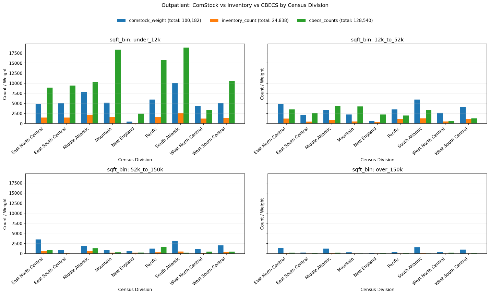
{:refdef}

{:refdef: style="text-align: center;"}
*Figure 23. Outpatient building count comparison by census division and building size bin*
{:refdef}

### Comparison – Retail (Other than Mall)
ComStock Retail standalone buildings map to the Retail (Other than Mall) CBECS PBA.

As shown in Figure 24, the CBECS estimate is much lower than the Building Inventory for 5 of 7 reported census divisions for Retail buildings. There could be a difference in building type classification, as many CoStar types are mapped to Retail. Otherwise, there are no strong hypotheses to explain the difference between the estimates.

In 3 of 7 reported divisions, the ComStock estimate falls inside the CBECS 95% CI.

Figure 25 compares Retail standalone building counts across three data sources by census division and floor-area size bin. Most buildings fall in the under-12k sqft bin, where the Building Inventory is generally the highest source and CBECS the lowest, though CBECS exceeds the others in a few divisions (e.g., West North Central). The larger size bins are sparse, with the Building Inventory consistently leading where counts appear.

{:refdef: style="text-align: center;"}
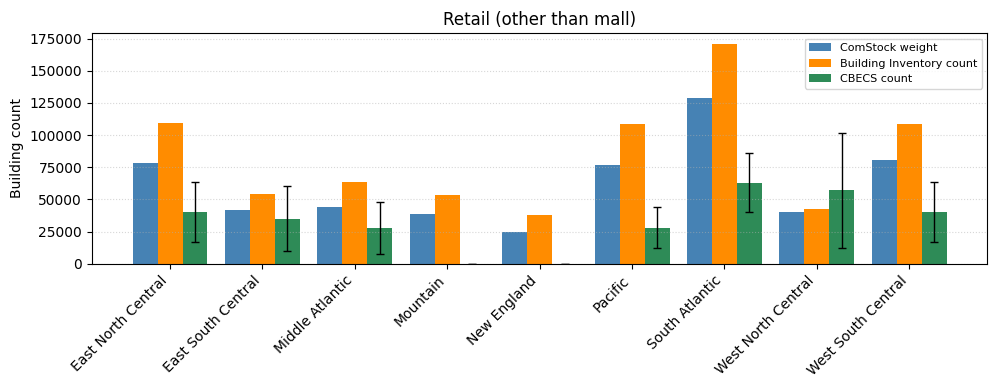
{:refdef}

{:refdef: style="text-align: center;"}
*Figure 24. Retail (other than mall) building count comparison by census division*
{:refdef}

{:refdef: style="text-align: center;"}
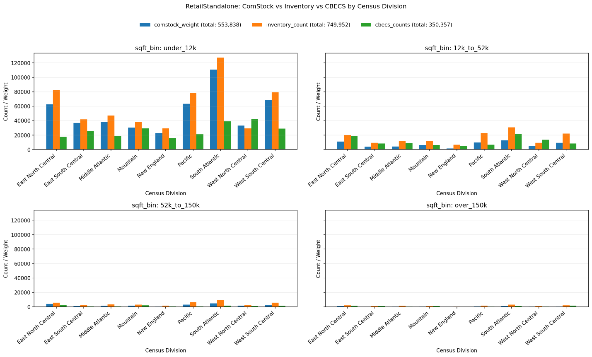
{:refdef}

{:refdef: style="text-align: center;"}
*Figure 25. Retail standalone building count comparison by census division and building size bin*
{:refdef}

### Comparison – Warehouse and Storage
ComStock Warehouse buildings map to the Warehouse and Storage CBECS PBA.

As shown in Figure 26, the Building Inventory estimates for warehouse and storage buildings are within the CBECS 95% CI for all 8 reported census divisions.

In 3 of 8 reported divisions, the ComStock estimate falls inside the CBECS 95% CI. No strong hypotheses for the differences.

Figure 27 compares warehouse building counts across three data sources by census division and floor-area size bin. ComStock has higher mid-size warehouse (12k–52k sqft) counts relative to the Building Inventory and CBECS, while small warehouses (under 12k sqft) counts are lower. For the larger size bins (52k–150k and over 150k sqft), ComStock counts consistently exceed both the Building Inventory and CBECS across nearly all census divisions.

{:refdef: style="text-align: center;"}
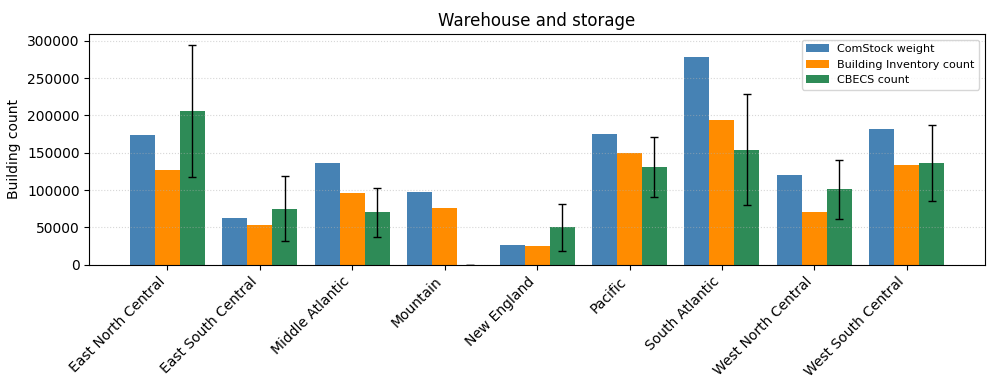
{:refdef}

{:refdef: style="text-align: center;"}
*Figure 26. Warehouse building count comparison by census division*
{:refdef}

{:refdef: style="text-align: center;"}
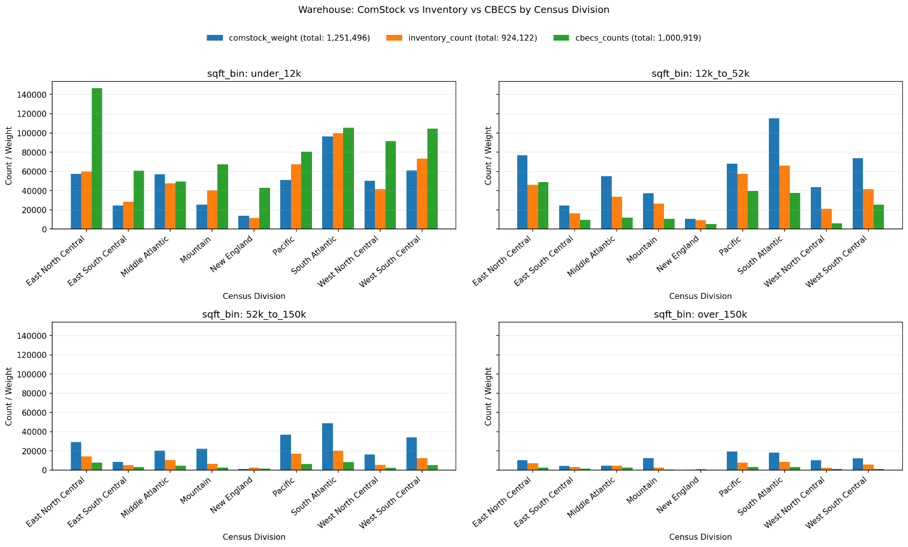
{:refdef}

{:refdef: style="text-align: center;"}
*Figure 27. Warehouse building count comparison by census division and building size bin*
{:refdef}

[^1]: U.S. EPA, “Portfolio Manager Technical Reference: U.S. National Energy Use Intensity” (2018), [energystar.gov/buildings/tools-and-resources/portfolio-manager-technical-reference-us-national-energy-use](https://www.energystar.gov/buildings/tools-and-resources/portfolio-manager-technical-reference-us-national-energy-use)

[^2]: U.S. EIA, “CBECS 2018: Building Characteristics Overview,” [eia.gov/consumption/commercial/pba/overview.php](https://www.eia.gov/consumption/commercial/pba/overview.php)
